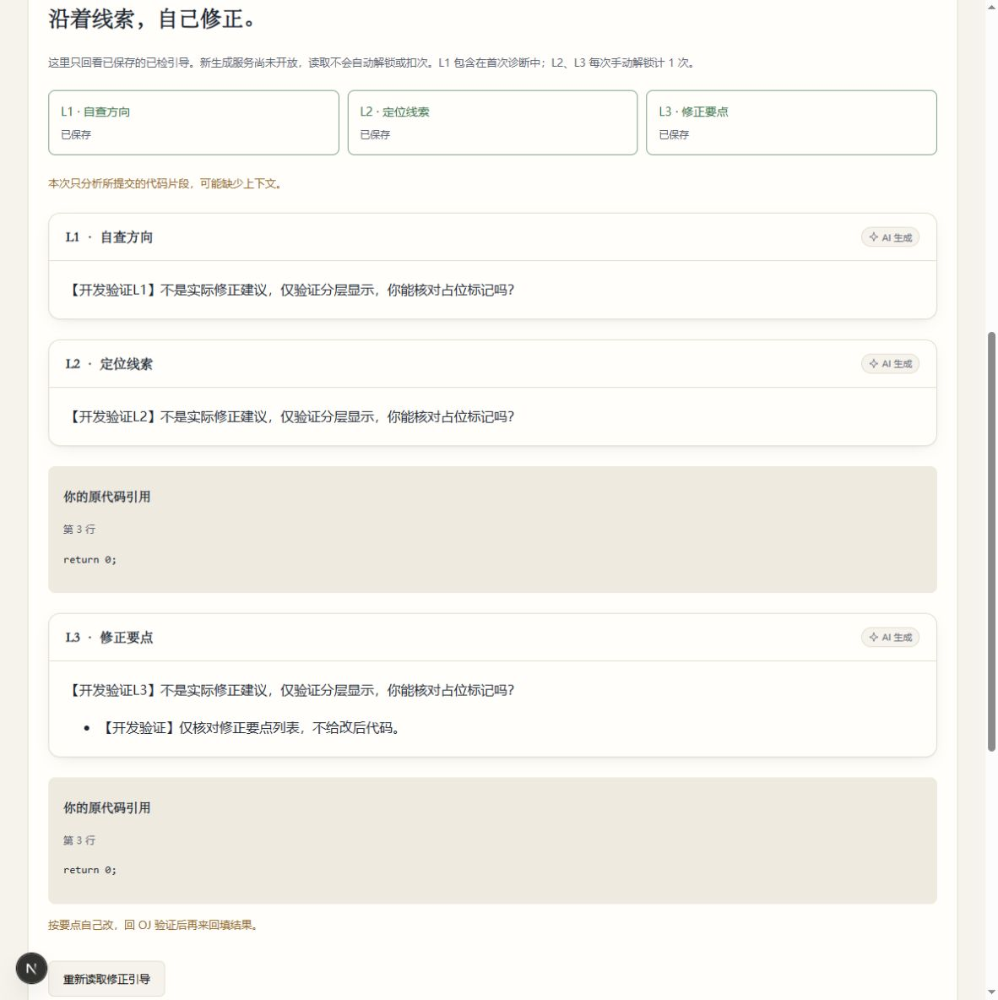

# TASK-0032 引导修正阶梯验证

2026-11-16；PBI-0016 AC1内部基础切片，分支task-0032-diagnosis-guidance。API 7c5fa29803f8850b66d87d126ecccd6958f097df，Web 387772b1def66f808fbd22fa12062bd3f2d2e393。PBI与G4仍未完成。

## 实现与边界

- 共享阶梯增加操作/消息类型及验证钩子，诊断结果不算修正L1。L1包含在原诊断计次中，L2/L3相邻显式受理各1次。
- 冻结来源诊断、错因、原确认材料、级别及revision；复用会话锁、幂等、互斥、期限与事务。检查后才发布guidance_l1/l2/l3，原诊断独立保存。
- L1自查方向、L2定位原代码、L3修正要点；均不提供完整改后程序。结构/代码标记规则不是语义合规证明；安全与边界回调必须分别实际True。
- 本人GET与PC回看接入；生成说明经AiContent，原代码引用转义。公开start/unlock严格验证后503；没有生产模型或默认放行检查器。

## 自动验证

- API ruff通过，mypy55源文件通过，PostgreSQL全量421项通过，无skip；新增引导专项36项。
- 覆盖免费L1、付费相邻解锁、同键重放/冲突、跳级拒绝、失败/超时/旧版本不发布、有限重试token累计、并发互斥、回滚、用户/类型隔离、结构与行号、缺失检查及隔离副本。
- Web lint/typecheck、271项测试与生产build通过；覆盖未解锁无内容、已检连续阶梯、原文转义、错模式/串会话拒绝、GET不带POST及失败保留。
- 0013→0012→head保留原2会话/4消息/8事件。保存引导后降级被保护拒绝，schema仍0013_guidance。

## PC与数据验证

- 历史条目进入原诊断后读取三级引导；开发占位、AI标识、代码片段提示、原代码第3行引用与L3要点显示正确。刷新及“重新读取修正引导”保持原内容。
- 页面使用同一已有本机QA，非真实诊断或修正。生产新生成未开放，已保存三级后无新解锁入口；移除原诊断卡片重复开始按钮。
- 浏览器前后PG核对：诊断消费1、引导unlock消费2；原追问1/讲题1不变。诊断消息1、引导消息3、steps3；原反馈solved/version2保持。读取不增加计次。

## 未满足与风险

真实模型/OCR/存储/输入输出安全/分层语义检查/预算未配置；真实输出质量与20例诊断一致性未验。运行中SSE、供应商取消、L1付费重试、诊断追问、变式、完整创建确认闭环及Mac实机仍待后续。本轮无发布或main合并。
